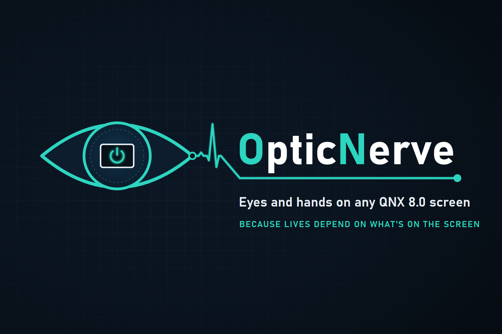

# OpticNerve



**Gives your test tools eyes and hands on any QNX 8.0 screen.**

> Status: work in progress for the QNX Global Hackathon (November to December 2026). The agent builds for QNX 8.0
> (aarch64le and x86_64) and runs on a Raspberry Pi 5 and on a QNX 8.0 QEMU target; OculiX sees and drives their
> screens through it.

## The problem

The HMI on a car dashboard, an infusion pump or a factory panel is tested by hand far more often than it should be.
GUI test tools run on a desktop host. To test an embedded target they need a way to see its screen and to act on it,
and teams either tap through test plans manually or build one-off rigs per product.

## The idea

OculiX (the open-source successor of SikuliX) automates GUIs by **seeing** the screen and **acting** on it, with
image matching and OCR. It runs on Windows, macOS and Linux. OpticNerve is the link to the target: the **OpticNerve
agent**, a small native program on the QNX 8.0 target that serves the screen to OculiX over VNC and tells a test
what it cannot learn from pixels alone.

```
  host (Windows / macOS / Linux)                     target (QNX 8.0: Raspberry Pi 5, or QEMU)
 +------------------------------+                   +---------------------------------------+
 |  OculiX 4.x test scripts     |   VNC (RFB 3.8)   |  opticnerve serve (our agent)         |
 |  image match, OCR, asserts   | <---------------> |   - reads the display (Screen API)    |
 +------------------------------+   port 5901       |   - injects pointer and keys (Screen) |
 |  helpers over SSH            | ----------------> |   - /dev/opticnerve: status, wait for |
 |   opticnerve status / wait   |                   |     a change, capture to a file       |
 +------------------------------+                   |  the app under test (any toolkit)     |
                                                    +---------------------------------------+
```

- **No Java on the target.** The agent is one native C program, `opticnerve`; the test logic stays on the host.
- **Toolkit-agnostic.** It works at the QNX Screen level, so it tests an app built with any GUI toolkit.
- **QNX-native.** One thread on a QNX dispatch loop: sockets, Screen's change signal, a timer and signals arrive as
  pulses and select events; `/dev/opticnerve` is a resource manager on the same loop.
- **Exact pixels.** Frames are 32 bits per pixel, read straight from the display: what the test compares is what
  the display shows. A viewer for a person (one that asks for a pointer shape) also gets an arrow drawn where the
  agent last put the pointer; test tools that ask for no pointer shape (OculiX VNCScreen) never do (`opticnerve
  pointer on|off`, ON-AG-001). While such a viewer is connected, the agent also holds the target's own USB mouse and
  passes its moves on itself, so the arrow follows that mouse too (`opticnerve mouse on|off`).
- **Frames only on change.** The agent tracks, for each client and each 64x64 tile, what the client has not been
  sent yet, so a test can rely on a frame being current, and can ask (`opticnerve current`).

## Layout

| Folder | Contents |
|---|---|
| `agent/core/` | The decision-making part of the agent, plain C11 with no QNX header: RFB 3.8 with VNC authentication (our own DES), the client table, tile marks and the schedule of captures and updates |
| `agent/qnx/` | The QNX driver: dispatch loop, sockets, Screen capture and injection, `/dev/opticnerve`, and the subcommands |
| `agent/tests/` | Tests of the core (`core_test`) |
| `agent/spikes/` | Small test programs used to settle design questions on the target (input injection, window placement) |
| `host/tools/` | Deploy script, a VNC snapshot tool and a VNC input tool (Python) |
| `host/poc/` | The PoC demo's commands on a Linux tester, with desktop shortcuts: the OculiX IDE, its VNC viewer, SSH to the Pi, the demo panel, a test run without the IDE, and installing the agent on the target ([list](host/poc/README.md)) |
| `host/qemu/` | The QEMU target: launch script, a 1920 x 1080 virtual display for Screen, and a tunnel to reach the guest ([bring-up](docs/QEMU_BRINGUP.md)) |
| `tests/regression/` | The [regression tests](tests/regression/README.md) to run after a change: `python -m pytest` (host only), `--pi` (also the target) |
| `host/tests/`, `host/spikes/` | Network robustness tests; OculiX probes for reading and for input |
| `sdp/` | The pinned QNX SDP baseline and the script that checks a build host against it |
| `docs/` | [Configuration management](docs/CONFIG_MANAGEMENT.md) (everything needed to reproduce the setup), the scripts' [settings](docs/SETTINGS.md) (addresses, ports, passwords) and the [OculiX issue list](docs/ISSUES.md) |

## What you need

| For | What | Used and tested here |
|---|---|---|
| Building | QNX SDP 8.0.5 from the QNX Software Center (the free QNX Everywhere licence), with `qcc`; the exact package list is `sdp/packages.lock` | Windows 11 (baseline SDP-BL-007) and Ubuntu 24.04 (SDP-BL-009): the same sources give byte-identical binaries on both |
| The target | Raspberry Pi 5 with the QNX 8.0 quick-start image (package `quickstart.rpi5` 0.5.0.00050, image 20260902), on the network, with its `qnxuser` login | Pi 5, image as shipped |
| Or a QEMU target | The QNX 8.0 QEMU quick-start image (package `quickstart.qemu` 0.5.0.00050) on an Ubuntu 24.04 host with QEMU; see [QEMU bring-up](docs/QEMU_BRINGUP.md) | QEMU 8.2.2 on Ubuntu 24.04, emulated CPU |
| Host tools | Python 3 with `cryptography` and `Pillow`; `ssh`, `scp` and `bash` | Python 3.14 on Windows (Git Bash) |
| OculiX | OculiX 4.0.0 (`oculixapi-4.0.0-<os>.jar`) and Java 17 or newer; for VNC, `tigervnc-java-oculix` 2.0.4 first on the classpath (configuration ON-VNC-1, below) | Temurin 25.0.4+7 |

## Build

1. Install the SDP and set its environment (`qnxsdp-env.bat` on Windows, `source qnxsdp-env.sh` on Linux), so that
   `QNX_HOST` and `QNX_TARGET` are set and `qcc` and `make` are on `PATH`.
2. Check the installation against the pinned baseline (optional, but it tells you the build host matches ours):

   ```
   python sdp/check_sdp.py <path to the SDP>
   ```

3. Build:

   ```
   cd agent
   make                  # both targets; or: make ARCH=aarch64le
   ```

   The results are `agent/build/<arch>/opticnerve` (the agent and its subcommands) and `agent/build/<arch>/core_test`.
   Everything builds with `-std=c11 -Wall -Wextra -Werror`. The aarch64le build runs on the Pi 5; the x86_64 build
   runs on the QEMU target, where DemoTest passes as on the Pi ([QEMU bring-up](docs/QEMU_BRINGUP.md), step 10).

4. Run the core tests on the target (they need no display): copy `agent/build/aarch64le/core_test` to the Pi and run
   it. It prints one line per failed check and a total (`45 checks, 0 failed`). A build of the core tests for a
   desktop host is planned; it is not there yet.

## Run

The scripts take the target's addresses, ports and passwords from the command line, the environment or a settings
file, `~/.config/opticnerve/env`: see [Settings](docs/SETTINGS.md), which lists every script's parameters and the
variable each one maps to. Set three of them first: `ON_HOST` (the Pi's address), `ON_LOGIN_PASSWORD` (the Pi's
`qnxuser` password, also used for `sudo`) and `ON_VNC_PASSWORD` (the password OpticNerve will ask VNC clients for, at
most 8 characters). Passwords travel to the Pi on the SSH connection's input, never on a command line.

```
python host/tools/opticnerve_deploy.py install     # copies the agent to /data/opticnerve/ and sets its password
python host/tools/opticnerve_deploy.py start       # starts the agent as root: VNC on port 5901
python host/tools/opticnerve_deploy.py status
```

Everything the agent needs lives in one folder on the Pi, `/data/opticnerve/`; nothing else on the target is changed.
To take it all off again:

```
python host/tools/opticnerve_deploy.py undo        # stops the agent and deletes /data/opticnerve/
```

**See the screen** with any VNC viewer at `<Pi address>:5901` and the VNC password, or with our tool:

```
python host/tools/vnc_snapshot.py - - frame.png      # the agent and password from the settings
```

**Drive it from OculiX** (configuration ON-VNC-1):

- classpath: `tigervnc-java-oculix-2.0.4.jar` first, then `oculixapi-4.0.0-<os>.jar`;
- before the first connection, limit the security types: `SecurityClient.secTypes.setParam("VncAuth,None")`;
- connect with `VNCScreen.start(host, 5901, password, 10, 1000)`;
- send Enter as `type("\r")`, and use the `Mouse.*` constants for buttons.

`host/spikes/probe/ReadOnlyProbe.java` (reading) and `host/spikes/oculix_input/OculixInputProbe.java` (input) are
complete examples:

```
java -cp "tigervnc-java-oculix-2.0.4.jar;oculixapi-4.0.0-windows.jar" host/spikes/probe/ReadOnlyProbe.java <Pi address> "$ON_VNC_PASSWORD" out 5901
```

(`:` instead of `;` between the jars on Linux and macOS.)

**On the target**, any user can ask the agent (switching needs root where marked):

| Command | What it does |
|---|---|
| `opticnerve status` | the status text: version, process ID, display, change count, captures, clients |
| `opticnerve wait [-timeout=S] [-since=COUNT] [-quiet=MS]` | waits for the next screen change (exit 0) or the timeout (exit 2); `-since` returns at once if the change count is already past COUNT; `-quiet` waits until the screen has settled (no change for MS); with `-since`, it first waits for a change past COUNT |
| `opticnerve current` | captures and says, for each VNC client, whether its last frame is current (a viewer that gets the pointer arrow is not current while a move of the arrow waits for its next request) |
| `opticnerve pointer [on\|off]` | shows, or switches (root), the pointer arrow drawn for viewers that ask for a pointer shape (on when the agent starts, unless `serve -nopointer`) |
| `opticnerve mouse [on\|off]` | shows, or switches (root), whether the agent holds the target's own USB mouse while a viewer that gets the arrow is connected, so the arrow follows that mouse too (on when the agent starts, unless `serve -nomouse`) |
| `opticnerve capture X Y W H FILE` | writes a region of the screen to FILE (PPM), as the calling user |
| `opticnerve stop` | stops the agent (root only) |
| `opticnerve passwd [-passfile=PATH] < password` | sets the VNC password and tells the agent (root only) |

Every request has a time limit: an agent that does not answer makes a command print "agent not answering" and exit 3.

## Tests

| Test | Where | What it checks |
|---|---|---|
| `agent/tests/core_test.c` | on the target | DES and VNC authentication against independent values; the handshake and its refusals; the tile marks and the schedule (a change made while a client is busy, partial requests, the hold-off between captures, the timed capture); release of held keys and buttons on disconnect; message limits; the pointer arrow (which clients ask for it, the list read across any split, the arrow's pixels in each format, the tiles marked when it moves, at the edges, and when a client or the switch changes); the target's own mouse while held (the count of clients that get the arrow, presses and releases kept where they happened however late the queue is read, 1.5 pixels a count, clamping, a full queue) |
| `host/tests/robustness.py <Pi>:5901` | from a host | wrong password, unknown messages, a fifth client, silent connections, a client that stops reading, 208 connections closed at every protocol state (a connection turned away while earlier ones still hold their slots waits for a free slot, up to 35 s, and the waits are reported: from macOS a connection closed by reset can hold its slot until the agent's keepalive, about 3 s) |
| `host/spikes/oculix_input/OculixInputProbe.java` | from a host | 15 OculiX input calls through the agent; what arrives is logged by `agent/spikes/input_log.c` on the target |

## The demo

Video: [OpticNerve demo on YouTube](https://www.youtube.com/watch?v=0gq-p9oGIgE) (no sound); the same recording is
in [`demo-recording/`](demo-recording/).

`agent/demo/demo_panel.c` is a small instrument panel for the target (three buttons, a counter, a lamp, a text line;
the X at the top right of its title bar closes it), and `host/demo/DemoTest.java` is the OculiX test that drives it
through the agent:

```
java -cp "tigervnc-java-oculix-2.0.4.jar;oculixapi-4.0.0-windows.jar" host/demo/DemoTest.java <Pi address> "$ON_VNC_PASSWORD" demo-out [-slow] [-fail] [-brief] [-repeat=N] [-cols=N]
```

`agent/demo/launch_panel.c` is the launcher panel: a full-screen panel with a tile for each app of the quick-start
image's launcher configuration (Developer Desktop, Terminal, Readme, GTK4 Demo, Gears, Maze) and one for GTK4 Widget
Factory. A click on a tile, from a viewer or a test, starts that app, as often as needed; Alt+Tab switches between
the apps and the panel, and Alt+Tab+Del with Tab held closes the app selected; these keys come from a script or the
target's own keyboard (a viewer on a laptop keeps Alt+Tab for the laptop). A tile shows RUNNING while an app the
panel started from it runs. It is installed with the agent and started over SSH before a test run:
`sh host/tools/launch_panel.sh start` (`stop`, `stop -apps`, `status`).

Every test and tool that sends input does it the way a hand does: the pointer glides to its target along a slightly
curved path at about 60 pointer events a second (0.5 to 0.8 s), rests, and clicks with the button held 50 to 90 ms;
keys come 60 to 180 ms apart (`host/tools/hand.py`, and the same model in each Java test and OculiX script). There is
no faster mode (`tests/regression/test_hand.py` checks that no test sends input any other way). The one exception is
`host/spikes/oculix_input/OculixInputProbe.java`, a probe of OculiX's own input calls. `-slow` adds a pause after each caption, for recording; `-brief` prints only the PASS and FAIL lines.

`host/demo/DemoTest.sikuli` is the same test as an OculiX IDE script, checked only by pictures and OCR as a test made
in the IDE is. Open it in the OculiX 4.0.0 IDE, started with the TigerVNC jar first (`java -cp
"tigervnc-java-oculix-2.0.4.jar;oculixide-4.0.0-windows.jar" org.sikuli.ide.Sikulix`), with `ON_HOST` and
`ON_VNC_PASSWORD` set; or set `ON_LOCAL_SCREEN=N` to run it on monitor N, where a VNC viewer shows the Pi full screen
at 100 % (checked with TigerVNC 1.16.2's viewer, 2026-11-19).

The demo video was recorded with `host/demo/video/record_take.py`, which runs the shots of `host/demo/video/take.sh`
in a full-screen terminal while OBS records (Windows with Git for Windows and OBS Studio; the OBS scene and the webcam
settings are in [Configuration management](docs/CONFIG_MANAGEMENT.md)). `--dry` runs the shots without OBS.

## Settings and limits

- **Port 5901**, VNC authentication only (type 2), RFB 3.8 only, Raw encoding, 32 bits per pixel; a client that asks
  for another 32-bit pixel format gets it converted, and a client that asks for 8 or 16 bits per pixel is closed.
- **At most 4 clients** at once, plus 2 connections that are still logging in. A connection has 10 s to reach the
  password prompt (version and security type; a program does this at once), then **60 s to answer it**, enough for a
  person typing into a viewer. If that time runs out, the login fails with the reason "login timed out: no password
  within 60 s", which a viewer can show, and the status counts it as `logins_timed_out`. The other side of this: two
  viewers left at their password prompts hold both login slots for up to a minute, and further connections are
  refused at once until then (`refused_at_accept`). `opticnerve serve -logintimeout=S` changes the 60 s; on a test
  bench `-logintimeout=0` takes the limit away, and then a prompt left open holds its login slot until the viewer
  closes. A client that reads nothing for 30 s while a frame is waiting for it is closed.
- **Input:** the client that sends input owns it, so a tester's viewer and a test script can take turns without
  either one disconnecting. The one exception: while the owner holds a key or a mouse button, other clients' input
  is dropped (counted as `pointer_dropped` and `keys_dropped`; the latter also counts presses beyond 32 held keys),
  so a click or a drag is never split, and a drag begun while input was elsewhere waits for its release. The owner's
  held keys and buttons are released when it disconnects. The status marks the owner's line `input_owner` and
  counts `input_handovers`. A tester moving the mouse in the viewer during a test run does move the target's
  pointer.
- **Captures:** at most one at a time, and never sooner after the last one than that one took (at least 33 ms by
  default, `-holdoff=MS`); a timed capture every 2 s while a client waits for a change.
- **Who can do what on the target:** the agent runs as root. Any user who can log in to the target can read its
  status and capture the screen through `/dev/opticnerve` without the VNC password; input needs a VNC connection and
  the password. Switching the pointer arrow or the mouse hold, stopping the agent and setting its password are root
  only. The launcher panel runs as root too, so any client with the VNC password can start the image's apps from it
  while it is up. This fits a single-user test target.
- **Input:** the agent injects input through Screen. It reaches application windows (the demo panel, a Terminal,
  the GTK apps) and the quick-start image's launcher: a click on a launcher tile opens its application
  (`host/demo/GtkDemoTest.java`), and Alt+Tab switches from the Developer Desktop to the launcher (both checked on
  2026-11-18). Our tests start applications over SSH as the launcher does (`host/demo/LoginTest.java`, the fallback
  in `host/demo/GtkDemoTest.java`), which works whatever is on the screen and whatever ran before. Injected keys carry the same key symbol and USB scan code as a real keyboard's.
- **The target's own mouse:** while a viewer that gets the arrow is connected (and `opticnerve mouse` is on), the
  agent holds the target's USB mouse and injects its moves itself, as it injects the viewer's; when the last such
  viewer goes, it gives the mouse back. The pointer may jump once at each of these hand-overs. If a launcher tile
  does not open its app while a viewer is connected, close the viewer and click the tile with the mouse. A mouse
  plugged in while the agent holds one stays with the system until the next hold. If the agent ever stops answering
  while it holds the mouse, it ends itself and the mouse is the system's again; `slay -9 opticnerve` does the same by
  hand.
- **Not addressed:** QNX security policies; encryption (VNC authentication is not meant for untrusted networks).
- **Not included:** boot images (the agent is deployed onto the quick-start image as it is shipped); start at boot.

## Future work

### A redaction layer

Hide sensitive areas of the screen from everything that leaves the target (tests, recordings, remote viewers),
updated live as the screen changes: a login screen, a generated key, a line on a censor list.

- **Where:** in the agent's frame stream. The agent already reads every frame and tracks changes in 64x64 tiles for
  each client; before a frame is sent, listed rectangles are blacked out or blurred. Nothing hidden leaves the
  target, and the rest of the frame stays exact. (An overlay window on the target's own display does not fit the
  quick-start image, where application windows are shown full screen.)
- **Detection has to happen on the target.** OCR in the test tool on the host would need the pixels before deciding
  to hide them. In order of effort:
  1. rules by application or window, which Screen reports to the agent ("when the Terminal shows `Password:`, hide
     the line after it"), and fixed rectangles;
  2. template matching in C on the frame (a known field, a known logo);
  3. OCR on the target with a censor list. This is research: it needs an OCR engine ported to QNX, and it adds
     latency to every changed region.
- **No leak while deciding:** a changed region's tiles are held back until detection has run on them, rather than
  sent and masked afterwards. The per-client tile marks make this a natural extension.
- **A first step:** `opticnerve redact X Y W H` (and `unredact`), a rectangle the agent blacks out in every frame it
  sends, set by a script on the target. Estimate for rules and rectangles: a few days, most of it tests.

Typed passwords are not the main case: a login prompt does not echo them. The cases are text that is shown, such as
a default password in a message of the day.

### OCR with word positions: Octachorix

[Octachorix](https://github.com/oculix-org/Octachorix), from the same family of repositories as OculiX, is a
Tesseract runtime for the JVM that returns text, word positions and confidences in one pass, and loads exactly the
native library it is given (paired with [Legerix](https://github.com/oculix-org/Legerix), which ships those
libraries). Word positions are what both the redaction layer's OCR rules and our OCR checks need (today
`LoginTest.java` compares whole-screen text). Octachorix is GPL-3.0 and OpticNerve is MIT, which matters if it is
ever bundled; using it from a test is the simpler path.

### Regression suites for the quick-start image

Sanity tests that could run after every fresh install of the QNX 8.0 quick-start image, driven by OculiX through the
agent with the mouse and keyboard only:

| Suite | What it checks |
|---|---|
| GTK Demo menu crawl | every item of the GTK Demo's sidebar is present (against a recorded tree), folders open and close, every demo enables Run and every folder does not. A first version is `host/demo/GtkDemoTest.java`: 111 items, about 6 minutes, with step times for items that need longer. |
| GTK Demo run | runs each demo from the sidebar, checks that its window opens and shows what the demo is about, and closes it. |
| Developer Desktop menu crawl | every item of the Xfce Applications menu and its submenus (Settings, Accessories, Development, Graphics, Internet, System) is present and can be opened. |
| Developer Desktop application run | starts each application from the menu, checks that its window opens, and closes it with the window's own close button. |
| Widget Factory Obstacle Course | GTK 4's Widget Factory has three pages with about 185 controls of every kind: entries, toggles, check and radio buttons, switches, sliders, spin buttons, drop-downs, notebooks, a calendar, menus, dialogs, panes, trees and a colour chooser. The course operates every control and checks its new state, timing each one. The score (controls cleared, failed, skipped; time per page) could serve as a benchmark for GUI test tools on embedded targets. |

Each suite starts its application from its launcher tile or over SSH (see Settings and limits) and needs nothing else
from the target than the VNC port once the application is on the screen.

## Licence

MIT. See [LICENSE](LICENSE).
