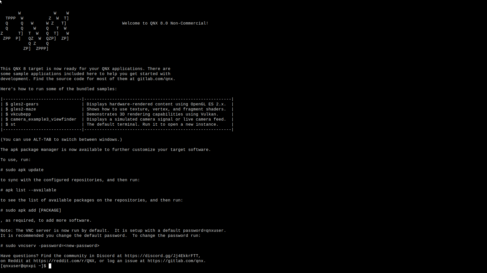

# Raspberry Pi 5: first boot of the QNX 8.0 quick-start image (2026-11-12)

## What was booted

- Image: `rpi5.img` from the quick-start package `quickstart.rpi5` 0.5.0.00050 (SDP-BL-005), SHA-256
  `66ba622976ccc69112f389c9b51eee91b5295e7f7da28844d49e7b0bdae5175c`. See
  [../CONFIG_MANAGEMENT.md](../CONFIG_MANAGEMENT.md).
- Written to a microSD with Raspberry Pi Imager (version not recorded). The card was not read back and hash-checked
  before booting, and it can no longer be: on first boot the image grew its `/data` partition to fill the card.
- Boots. On Ethernet it took 10.30.1.116 by DHCP (the address may change).
- Login over SSH as `qnxuser` with the image's documented default password. `qnxuser` is in the groups `sudo` and
  `screen`, among others.

## What the target reports

| Item | Value |
|---|---|
| `uname -a` | `QNX qnxpi 8.0.0 2026/06/05-16:21:14EDT RaspberryPi5 aarch64le` |
| Hostname | `qnxpi` |
| Filesystems | `/` IFS (19 MB), `/boot` FAT 800 MB, `/usr` QNX6 9.9 GB, `/data` QNX6 31 GB (grown on first boot) |
| Open TCP ports | 22 (SSH), 5900 (VNC), 8000 (qconn, the QNX debug agent) |
| Screen | `/dev/screen` present; configs in `/system/etc/system/config` (`img.conf`, `mtouch.conf`, `scaling.conf`) |

`pidin` and `ps` as `qnxuser` show only the user's own processes, so which services run, and under which user, is
not known yet.

## A VNC server is already running

Port 5900 answers `RFB 003.008` and offers one security type: VNC password. The login message (`/etc/motd`) says the
VNC server runs by default with the default password `qnxuser`, and that it can be changed with
`sudo vncserv -password=<new-password>`.

First frame, taken with `host/tools/vnc_snapshot.py` (view-only; it sends no input): framebuffer 1920 x 1080, server
pixel format 16 bpp, desktop name `RaspberryPi5`. The HDMI screen showed the terminal (`st`) with the login message:

The login message also says the image has the `apk` package manager (`sudo apk add`) for adding target software.
Anything added that way changes the target, so it has to be recorded like an SDP change. Of the samples the login
message lists, `vkcubepp` shows LunarG's logo, a third-party trademark: keep it out of the demo video.

`/system/bin/vncserv` (also at `/bin` and `/usr/bin`) is byte-identical to the SDP's
`target/qnx/aarch64le/bin/vncserv` from `target.screen.vncserv` 4.2.0.00070 (SHA-256
`fb0f57653e733bb8f1fad8e77c546f615fd2726313ee3247beed8c78004fcdac`). It is started as `vncserv -display=1 -auth`
from `/system/etc/startup/post_startup.sh`.

`vncserv`'s usage text: "Events from the keyboard and mouse are forwarded to Screen". Its options, from the same
text: `-display=` (which Screen display to read), `-port=`, `-format=` (readback pixel format, default `rgb565`;
`rgba8888` and others available), `-name=`, `-fps` (draws the frame rate in the corner of each frame), `-use_touch`
(turns mouse buttons into touch contacts), `-verbose`, `-password=`, `-auth`.

QNX's own Screen VNC server already runs on the target, which made building the ON agent on `vncserv` an option.

## Developer Desktop

After a reboot David chose "Developer Desktop" from the boot launcher (`/system/etc/desktop_files/qnx_dev_desktop.desktop`).
It runs `/usr/bin/startDesktop.sh`: Weston (Wayland compositor) full screen on QNX Screen, shell
`qnx-desktop-shell.so`, with an XFCE session inside (`~/.config/weston.ini`, which also loads `screen-share.so`).
`vncserv` is unchanged (`vncserv -display=1 -auth` from `/system/etc/startup/post_startup.sh`).
