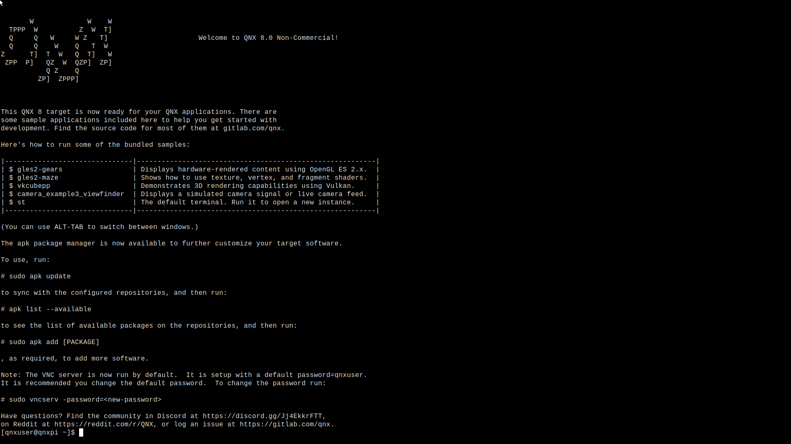
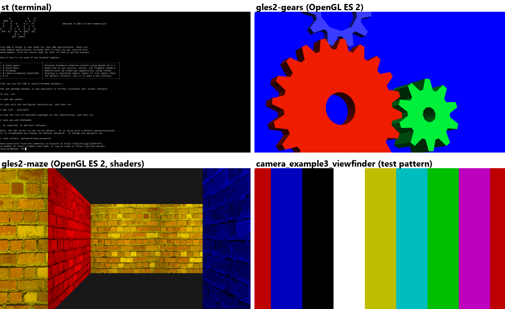
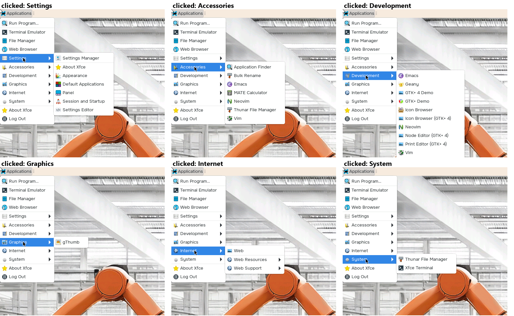

# Raspberry Pi 5: first boot of the QNX 8.0 quick-start image (2026-11-12)

## What was booted

- Image: `rpi5.img` from the quick-start package `quickstart.rpi5` 0.5.0.00050 (SDP-BL-005), SHA-256
  `66ba622976ccc69112f389c9b51eee91b5295e7f7da28844d49e7b0bdae5175c`. See
  [../CONFIG_MANAGEMENT.md](../CONFIG_MANAGEMENT.md).
- Written to a microSD with Raspberry Pi Imager (version not recorded). The card was not read back and hash-checked
  before booting, and it can no longer be: on first boot the image grew its `/data` partition to fill the card.
- Boots. On Ethernet it took 10.30.1.116 by DHCP (the address may change).
- Login over SSH as `qnxuser` with the image's documented default password. `qnxuser` is in the groups `sudo` and
  `screen`, among others.

## What the target reports

| Item | Value |
|---|---|
| `uname -a` | `QNX qnxpi 8.0.0 2026/06/05-16:21:14EDT RaspberryPi5 aarch64le` |
| Hostname | `qnxpi` |
| Filesystems | `/` IFS (19 MB), `/boot` FAT 800 MB, `/usr` QNX6 9.9 GB, `/data` QNX6 31 GB (grown on first boot) |
| Open TCP ports | 22 (SSH), 5900 (VNC), 8000 (qconn, the QNX debug agent) |
| Screen | `/dev/screen` present; configs in `/system/etc/system/config` (`img.conf`, `mtouch.conf`, `scaling.conf`) |

`pidin` and `ps` as `qnxuser` show only the user's own processes, so which services run, and under which user, is
not known yet.

## A VNC server is already running

Port 5900 answers `RFB 003.008` and offers one security type: VNC password. The login message (`/etc/motd`) says the
VNC server runs by default with the default password `qnxuser`, and that it can be changed with
`sudo vncserv -password=<new-password>`.

First frame, taken with `host/tools/vnc_snapshot.py` (view-only; it sends no input): authentication OK, framebuffer
1920 x 1080, server pixel format 16 bpp, desktop name `RaspberryPi5`. One full frame in raw encoding took 0.29 to
0.41 s over Ethernet and Wi-Fi. The HDMI screen showed the terminal (`st`) with the login message:

The login message also says the image has the `apk` package manager (`sudo apk add`) for adding target software.
Anything added that way changes the target, so it has to be recorded like an SDP change.

`/system/bin/vncserv` (also at `/bin` and `/usr/bin`) is byte-identical to the SDP's
`target/qnx/aarch64le/bin/vncserv` from `target.screen.vncserv` 4.2.0.00070 (SHA-256
`fb0f57653e733bb8f1fad8e77c546f615fd2726313ee3247beed8c78004fcdac`).

## The bundled samples over VNC

David started each sample from the login message on the Pi (display on HDMI0), and frames were taken with
`host/tools/vnc_snapshot.py` while it ran. Every one came through, with consecutive frames differing, so the capture
is live:

| Sample | Rendering | Captured | Notes |
|---|---|---|---|
| `st` | terminal | yes | the first frame above |
| `gles2-gears` | OpenGL ES 2 | yes | all three gears, the blue one on the blue background included; shading changes with the light angle |
| `gles2-maze` | OpenGL ES 2, textures and shaders | yes | brick texture detail sharp |
| `vkcubepp` | Vulkan | yes | the cube shows LunarG's logo, a third-party trademark: keep it out of the demo video |
| `camera_example3_viewfinder` | camera / video | yes | a moving colour-bar test pattern: no camera driver is configured for the case's CSI camera |

Each one-shot frame (new connection, login, full 1920 x 1080 frame uncompressed) took 0.25 to 0.45 s. The server's
native pixel format is 16 bpp; the frames showed no visible banding, but fine gradients may band at that depth.

This bears on phase 1: QNX's own Screen VNC server already runs on the target and shows the whole display, GPU,
Vulkan and video layers included, and (below) it accepts keyboard and pointer input. That makes building the ON
agent on `vncserv` a real option rather than writing a VNC server. Still to measure: its frame rate with
incremental updates and its CPU load on the Pi.

## Input over VNC

Sent with `host/tools/vnc_input.py` into the terminal (`st`), with frames taken before and after:

| Input | Result |
|---|---|
| keys `o`, `n` (no Enter) | `on` appeared after the prompt; only that 30 x 20 pixel area changed |
| BackSpace twice | the frame became pixel-identical to the one before typing |
| pointer move in a square, 8 s | David saw the pointer trace the square on the monitor and stop in the centre |
| left click, left-button drag | no visible change; `st` doesn't select text with a real mouse either, so this shows nothing either way |

So `vncserv` forwards keyboard and pointer input to Screen, as its usage text says ("Events from the keyboard and
mouse are forwarded to Screen"; `-use_touch` turns mouse buttons into touch contacts). The mouse cursor is never in
the captured frames: it stays drawn at the top-left corner in every frame, so it is probably a separate cursor
layer that the readback doesn't include. Oculix knows where it clicks, so this is not a blocker.

`vncserv` options from its usage text: `-display=` (which Screen display to read), `-port=`, `-format=` (readback
pixel format, default `rgb565`; `rgba8888` and others available), `-name=`, `-fps` (draws the frame rate in the
corner of each frame), `-use_touch`, `-verbose`, `-password=`, `-auth`.

## Developer Desktop: clicks land

After a reboot David chose "Developer Desktop" from the boot launcher (`/system/etc/desktop_files/qnx_dev_desktop.desktop`).
It runs `/usr/bin/startDesktop.sh`: Weston (Wayland compositor) full screen on QNX Screen, shell
`qnx-desktop-shell.so`, with an XFCE session inside (`~/.config/weston.ini`, which also loads `screen-share.so`).
`vncserv` is unchanged (`vncserv -display=1 -auth` from `/system/etc/startup/post_startup.sh`).

- The first frame after the desktop came up was entirely black, while the monitor showed the desktop with the
  Applications menu open. A few minutes later, after David opened a terminal from the menu, frames showed the whole
  desktop. Cause not known; one black frame is worth watching for.
- Weston draws the mouse pointer into its output, so on this desktop the pointer is in the captured frames.
- A left click on "Applications" (55, 12) opened the menu. A click on each entry with a "more" arrow (Settings,
  Accessories, Development, Graphics, Internet, System) opened its submenu, highlighted, with the pointer where the
  click was sent.
- A second-level test went wrong: a click meant for "Internet > Web Resources" was sent 15 pixels too high, near
  "Web". The menu closed; no new window or taskbar entry appeared. Lesson for the tooling: locate the target in the
  current frame before clicking, which is what Oculix does.

## Not checked

- Clicks on buttons inside an application (the web browser is open for this).
- `-use_touch` mode, for touch-screen HMIs.
- Frame rate with incremental updates, and CPU load on the Pi while serving.
- Which user `vncserv` runs as, and its command line.
- Whether a stock VNC viewer works with it (none is installed on the Windows host).
