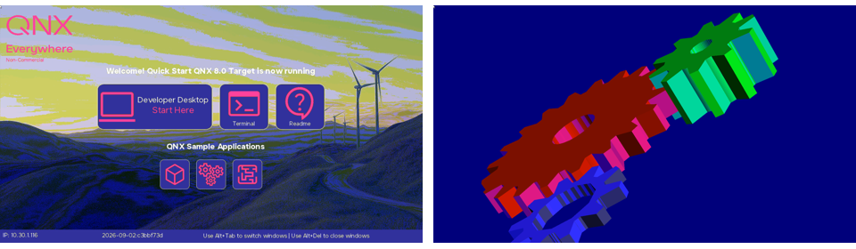

# Phase 2 spikes S2 to S6 on the Pi 5 (2026-11-12)

The spikes are defined in [../DESIGN.md](../DESIGN.md). S1 (Oculix against `vncserv`) waits for the Oculix release to
be pinned. Everything below was run from the Windows host over SSH and VNC.

## Setup

- Target: Pi 5 at 10.30.1.116, QNX quick-start image as recorded in [../CONFIG_MANAGEMENT.md](../CONFIG_MANAGEMENT.md),
  in the **Developer Desktop session** (Weston + XFCE). `fullscreen-winmgr` and `demolauncher` were running as well.
  The display showed Weston's lock screen ("Unlock your desktop") during most of the runs.
- Test program: [../../agent/spikes/screen_probe.c](../../agent/spikes/screen_probe.c), built on the Windows host
  (`C:\Users\root\qnx800_2`, baseline SDP-BL-005) with
  `qcc -Vgcc_ntoaarch64le -Wall -O2 -o screen_probe screen_probe.c -lscreen`. Root parts run with `sudo`.
- VNC tools: `host/tools/vnc_snapshot.py`, `host/tools/vnc_input.py`, and `host/tools/vnc_rate.py` (new, S6).

**Target change:** `/tmp/screen_probe` (SHA-256 `6eded5f1e0a7095f6c2f77548bd143ac941ed44fec9f0f5a0b7c35f8a6c9828e`,
the second build; the first was `83f901f9...`) is on the Pi. `/tmp` is on the persistent `/data` partition, so it
survives a reboot. Delete it with `rm /tmp/screen_probe`. Capture files and logs written during the spikes were
deleted. Nothing else on the target was changed.

## Results

| # | Question | Answer |
|---|---|---|
| S2 | Does `screen_read_display()` give the same pixels as `vncserv`? | **Yes.** Root only (as `qnxuser`: `EACCES` creating the display manager context). Full 1920 x 1080 in 0.03 s (`vncserv` one-shot: 0.31 s); a region (400 x 300) equals the same crop of the full capture. Against a VNC frame taken seconds later, almost every pixel differs slightly (1,905,906 of 2,073,600; still 951,960 after cutting both to rgb565 bits), because `vncserv` reads back as rgb565 and apparently rounds rather than truncates. Only 68 pixels differ by more than 8 levels, all in an 8 x 15 box at (0,0): the VNC frame has an extra white pointer there that the Screen capture does not. Weston's own (black) pointer is in both. |
| S3 | Can a window manager context see other apps' windows? | **No, not on this image.** `SCREEN_WINDOW_MANAGER_CONTEXT` fails with `EBUSY` because `fullscreen-winmgr` is running. A display manager context gets `CREATE` events only for the display and 5 input devices, no windows, and a window count of 0. |
| S4 | Does a keep-awake window stop blanking? | **Not needed for Screen, no help for Weston.** Screen's display idle timeout is **0** (idle off), idle state stays 0, power mode stays `SCREEN_POWER_MODE_ON`. The probe's keep-awake window is counted (`KEEP_AWAKES` 1), but there is nothing for it to keep awake. The blanking and lock come from Weston: `~/.config/weston.ini` has `locking=true`, and no `idle-time`, so Weston's default applies (300 s upstream; not checked on this build). |
| S5 | Does `screen_notify(SCREEN_NOTIFY_UPDATE)` fire per composition? | **Yes.** One pulse per composition, and it stays registered without re-arming: 60 pulses = 60 in Screen's own update counter. A second run that re-armed after each pulse also matched (6 = 6), so re-arming is not needed. The same five pointer moves gave 60 compositions the first time and 6 the second; possibly the first moves woke Weston out of its idle fade (hypothesis, not checked). On a static screen: 0. Every composition updated the full 1920 x 1080 (`update_pixels` / `update` = 2,073,600). |
| S6 | `vncserv` frame rate with a viewer that stays connected | Every incremental update is **one full-frame rectangle, even when nothing changed**: 25 frames in 4 s while Screen composed 0. Raw 32 bpp: 8.29 MB a frame, 5 to 6 frames/s to this Wi-Fi host, about 27 ms of `vncserv` CPU a frame. ZRLE (offered 16,0): 1.22 MB a frame, 2.2 frames/s, about 0.4 s of CPU a frame. Measured with `pidin -p vncserv times`. |

### Two side findings

- **Screen's display metrics reset when read, for every reader.** `status` read the counters twice in a row: the
  second read was all zeros. A later reader (root) also got zeros after an earlier read by `qnxuser`. So the
  metrics are shared and destructive; the agent must not rely on them, and must not read them while someone else
  does.
- **Screen sent an `IDLE` event** to the display manager context when the keep-awake window was posted, although
  idle is off. Not followed up.

The VNC frame of the lock screen, scaled down:

## What this means for the design (proposed, for David)

- **Frame freshness is the agent's main job.** `vncserv` resends the whole frame on every request, changed or not,
  so a VNC viewer cannot tell a live screen from a frozen one. `screen_notify(SCREEN_NOTIFY_UPDATE)` can, cheaply.
  Use it alone; not the metrics.
- **Drop keep-awake from the agent.** Screen does not idle on this image. The blanking and lock are Weston's, so
  they are handled on the Weston side: either `idle-time=0` (and possibly `locking=false`) in `weston.ini` on test
  targets, as a recorded target change, or the test tooling detects the lock screen and unlocks it. The native
  Screen demo HMI is not affected by Weston at all.
- **Keep idle and power state in the status** (cheap), but they say nothing about Weston's lock.
- **Drop the window list** (the stretch goal): it needs `fullscreen-winmgr` replaced. Under Weston, desktop apps
  are Wayland surfaces anyway, not Screen windows. (`SCREEN_PROPERTY_WINDOWS` applies to a context only, so a display
  manager context cannot list other apps' windows either.)
- **Region capture works** and is ten times faster than a VNC frame, so `on capture` is worth having for assertions
  and as a cross-check of VNC frames. A cross-check needs a tolerance of about 8 levels per channel, because VNC
  frames are rgb565 (or `vncserv -format=rgba8888`, a recorded target change, see Risks in the design). Oculix's
  image-match similarity threshold must allow for the same.
- **Pointer at (0,0):** Oculix image matching near the top-left corner can hit the extra pointer `vncserv` draws
  there. Check again in S1.
- **VNC speed:** about 5 frames/s raw on this link. Fine for step-and-check tests, not for animation. A wired host
  or a smaller region per request may help; measure again with Oculix in S1. `vncserv` has an `-fps` option, not
  tried: it may cap the rate of these resent frames.

## Graphics stack crash on the Pi, 21:43 UTC

At 21:43:23 UTC (16:43 Eastern) `drm-rpi5`, `screen` and `rpi_thermal` all terminated within the same minute. `dumper`
wrote `drm-rpi5.core` (555 MB), `screen.core` (97 MB) and `rpi_thermal.core` (2 MB) to `/data/var/dumper/`. `mtouch`
logged "Screen connection failed or closed" at 21:43:28 and has retried every 10 s since. `vncserv` kept running and
now serves a 640 x 480 blue frame: "Screen display dpy-1 not found!".

My last command on the Pi was at about 21:36:51 (cleanup, no Screen calls); the last Screen calls (S6, `watch`) were
a few minutes before that. Nothing of ours was running at 21:43. The pointer moves of S5/S6 were the last input, so
Weston's idle timeout (300 s upstream default) would have expired at about 21:40 to 21:41. Cause unknown; the three
processes failing together points at the display driver or the firmware they share, not at Screen alone. The cores
have not been analysed. Recovery needs a reboot.

## S1 (started 2026-11-12, against the crashed display)

OculiX 4.0.0 (`oculixapi-4.0.0-windows.jar`, pinned in [../CONFIG_MANAGEMENT.md](../CONFIG_MANAGEMENT.md)), Java
Temurin 25.0.4, program [../../host/spikes/s1/S1VncScreen.java](../../host/spikes/s1/S1VncScreen.java):

- **Connect: yes.** `VNCScreen.start(host, 5900, password, 10, 1000)` negotiated RFB 3.8, authenticated with the VNC
  password and started in 3.45 s.
- **Capture: yes.** `capture()` returned the 640 x 480 error frame in 0.16 to 0.18 s. Bounds follow the server
  framebuffer (640 x 480 here).
- **Image search: fails in OculiX.** `Region.exists(Pattern)` on the `VNCScreen` throws
  `ClassCastException: DataBufferInt cannot be cast to DataBufferByte` at `org.sikuli.support.Commons.getMatList
  (Commons.java:2541)`, from `Finder.setScreenImage`. The VNC capture is an int-backed image and the finder expects a
  byte-backed one. Looks like an OculiX bug in the VNC path (to report upstream). Workaround to try: convert the
  capture to `TYPE_3BYTE_BGR` and run the `Finder` on that image, then click through the `VNCScreen`.
- **Click: not tested** (nothing to click on the error frame).

### S1 rerun after the reboot (23:4x UTC): yes, with a workaround

David asked for a reboot, keeping the cores (they are still in `/data/var/dumper/`). Rebooted with
`sudo shutdown -S reboot`; it came back in the **native session** (`fullscreen-winmgr` + `demolauncher`, no Weston),
display 1920 x 1080 again.

- `VNCScreen.start`: 3.3 s; bounds 1920 x 1080 (they follow the server framebuffer).
- `capture()`: 0.21 to 0.24 s for a full frame (`BufferedImage` type 0, custom, which is what breaks the finder).
- `VNCScreen.exists(Pattern)`: still the `ClassCastException`.
- **Workaround works:** copy the capture into a `TYPE_3BYTE_BGR` image and run `new Finder(image)`. The Gears tile
  (a 116 x 116 crop of an earlier capture) was found at score 1.0000 at (958,768) in 0.10 to 0.27 s.
- `VNCScreen.click(location)` launched the gears demo; the capture 2 s later shows it running.
- The extra white pointer at (0,0) shows in OculiX's captures too.

Caveat: the pattern was cut from a capture of the same session, so a score of 1.0 is the easy case. Patterns made
elsewhere (another session, the Screen capture, a reference image) will score lower, by about the rgb565 rounding
seen in S2.

## Open

- S1 follow-ups: report the `VNCScreen.exists` bug to OculiX; try `-fps`; patterns from another source.
- The 21:43 crash: cause (the cores), and whether it repeats after Weston's idle timeout. Not seen again yet; the Pi
  is now in the native session with gears running.
- Why the earlier black frame: Weston blanking before the lock screen is now the likely cause (Screen's idle is off
  and the power mode stays on). To confirm, take frames across Weston's idle time.
- The native Screen session (without Weston) was not tested; Screen's idle timeout of 0 suggests it does not blank.
